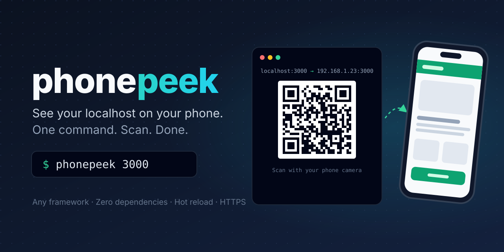

<p align="center">
  
</p>

<h1 align="center">phonepeek</h1>

<p align="center">
  <b>See your localhost on your phone in one command.</b><br>
  Scan a QR code. No deploy, no account, no config, no dependencies.
</p>

<p align="center">
  <a href="https://github.com/nkechr1s/phonepeek/actions/workflows/ci.yml"></a>
  <a href="LICENSE"></a>
  
  
</p>


## Why

Testing a site on a real phone usually means deploying it or fiddling with `--host 0.0.0.0`, firewall settings and "invalid host" errors. phonepeek does it in one command, and works with **any** project that serves on a local port: Next.js, Vite, Astro, Remix, Laravel, Django, Rails, PHP, or a plain static folder.

## Install

```sh
curl -fsSL https://github.com/nkechr1s/phonepeek/releases/latest/download/install.sh | sh
```

Needs Node.js 20+. Installs one file to `~/.local/bin/phonepeek` (override with `PHONEPEEK_DIR`), only from a [tagged release](https://github.com/nkechr1s/phonepeek/releases), and only if its SHA-256 checksum matches. Pin a version with `PHONEPEEK_VERSION=v0.2.0`.

Prefer to look first? Download, read, then run:

```sh
curl -fsSLO https://github.com/nkechr1s/phonepeek/releases/latest/download/install.sh
less install.sh && sh install.sh
```

**Windows:** download `phonepeek.js` from the [latest release](https://github.com/nkechr1s/phonepeek/releases/latest) and run `node phonepeek.js 8000`.

**Update:** run the install command again. **Uninstall:** `rm ~/.local/bin/phonepeek` (and `rm -r ~/.phonepeek` for HTTPS certificates).

## Usage

```sh
phonepeek          # auto-detects your running dev server
phonepeek 8000     # or name the port
phonepeek 8000 --https   # for payments (Stripe), camera, etc.
phonepeek --help
```

Start your dev server as usual, run phonepeek, scan the code. Your phone and computer must be on the **same Wi-Fi**.

The link is **private**: it contains a secret that changes every run. Only a browser that opened it gets in; anyone else on the Wi-Fi gets `403 Forbidden`. If the Wi-Fi has no password, phonepeek warns you.

## Use it from your AI coding agent

Add the phonepeek skill, and Claude Code (or any agent that supports [skills](skills/phonepeek/SKILL.md)) will use it when you say things like *"show this on my phone"*. It picks the port, adds `--https` for checkout and camera pages, and stops phonepeek when you're done.

```sh
mkdir -p ~/.claude/skills/phonepeek
curl -fsSL https://raw.githubusercontent.com/nkechr1s/phonepeek/main/skills/phonepeek/SKILL.md -o ~/.claude/skills/phonepeek/SKILL.md
```

It's one short Markdown file: [read it](skills/phonepeek/SKILL.md) before adding it.

## How it works

phonepeek starts a small proxy on your Wi-Fi address that forwards to `localhost:<port>`:

- **Works without server flags.** Requests are forwarded as if they came from `localhost`, so you don't need `--host 0.0.0.0`, and Next.js `allowedDevOrigins` / Vite `allowedHosts` checks don't block your phone.
- **Absolute links are fixed.** URLs like `http://localhost:8000/app.css` (Laravel `APP_URL`, redirects, JSON) are rewritten to your computer's address. On a phone, `localhost` would mean the phone itself.
- **Hot reload works.** WebSockets pass through.
- **Same port.** The phone URL uses your app's port when it's free.
- **Auto-detect.** With no port, it probes 3000, 3001, 4200, 4321, 5173, 5500, 8000, 8080 and 8081.

## HTTPS mode

Some browser features only work on `https` (or on `localhost`), for example Stripe and other payment forms, `crypto.randomUUID`, the camera, geolocation and service workers. Over plain `http`, a page that uses them may show up **blank** on the phone.

```sh
phonepeek 8000 --https
```

phonepeek creates a small certificate authority (with `openssl`, stored in `~/.phonepeek/`, private keys readable only by you). **Install it on your phone once**, so the connection is trusted and can't be intercepted:

- **iPhone:** AirDrop `~/.phonepeek/ca.crt` to the phone → **Settings → Profile Downloaded → Install**. Then **Settings → General → About → Certificate Trust Settings** → turn on **phonepeek local CA**.
- **Android:** copy `ca.crt` to the phone → **Settings → Security → Encryption & credentials → Install a certificate → CA certificate**.

phonepeek prints the certificate's SHA-256 fingerprint. To be sure you installed the right one, compare it with the fingerprint shown on the phone (iPhone: tap the profile → **More Details**).

**Is installing a certificate safe?** This one can only vouch for private network addresses (`192.168.x.x`, `10.x.x.x`, `172.16–31.x.x`), never for real websites. That limit is written into the certificate itself, so even if someone stole the key from your computer, they couldn't impersonate Google, your bank or any other site. This is [tested](test/security/tls.test.js). To remove it, delete the profile on the phone (**Settings → General → VPN & Device Management**).

You can skip installing it and tap through the "not private" warning instead, but then someone on the same network could intercept the connection.

## Troubleshooting

| Problem | Fix |
|---|---|
| Phone can't load the page | Allow incoming connections for `node` when macOS / Windows asks. |
| "This phonepeek link is private" | Scan the QR code again: the link changes every time phonepeek starts. |
| "Not private" warning with `--https` | Install the phonepeek certificate on your phone (see [HTTPS mode](#https-mode)). |
| Still nothing | Public or office Wi-Fi often blocks device-to-device traffic. Use your phone's hotspot. |
| Page is blank (often checkout / payments) | Run with `--https`. |
| "Nothing is answering on localhost:8000" | Start your dev server first, or pass the right port. |
| Wrong network IP shown | Another adapter (VPN, Docker) was picked. Disconnect it and retry. |

## Limitations

- Same network only. For a public link use a tunnel such as `cloudflared tunnel --url localhost:8000`.
- Text responses are buffered so links can be rewritten; streamed HTML shows up all at once.
- Without `--https`, traffic between your phone and computer is unencrypted, like any `http://` dev server on your network.

## Is it safe?

Don't take our word for it. Every claim below is checked by an automated test that runs on Linux, macOS and Windows for every change ([CI](https://github.com/nkechr1s/phonepeek/actions/workflows/ci.yml)).

| Claim | Proof |
|---|---|
| Only the person who scanned the QR code can open your app. Others on the Wi-Fi get `403` and your app never sees their requests (including websockets). | [`test/security/private-link.test.js`](test/security/private-link.test.js), [`test/e2e/cli.test.js`](test/e2e/cli.test.js) |
| A new secret every run; old links stop working; Ctrl+C really closes it. | [`test/e2e/cli.test.js`](test/e2e/cli.test.js) |
| Other websites can't borrow your phone's "localhost" identity, and nobody can fake `127.0.0.1` via `X-Forwarded-For` or inject a fake `Host`. | [`test/security/headers.test.js`](test/security/headers.test.js) |
| No request smuggling through websockets. | [`test/security/smuggling.test.js`](test/security/smuggling.test.js) |
| Can't be used to reach other ports or machines (no SSRF), and broken or hostile traffic doesn't crash it. | [`test/security/robustness.test.js`](test/security/robustness.test.js) |
| The HTTPS certificate authority can't be abused for real websites or public IPs; keys are private to you. | [`test/security/tls.test.js`](test/security/tls.test.js) |
| The installer refuses a tampered download and installs nothing. | [`test/e2e/install.test.js`](test/e2e/install.test.js) |

And things you can check yourself in a minute:

- **One readable file, zero dependencies.** [`phonepeek.js`](phonepeek.js) is the whole program: nothing downloaded at runtime, no `node_modules`.
- **It never talks to the internet.** It only connects to `localhost` (your app) and answers your phone. No telemetry. Check with `grep -nE "request\(|connect\(|fetch\(" phonepeek.js`.
- **Releases are built by GitHub, not on someone's laptop.** Each release is built from a tagged commit by [this workflow](.github/workflows/release.yml), after all tests pass, with a signed [build provenance attestation](https://docs.github.com/actions/security-guides/using-artifact-attestations). Verify your copy:

  ```sh
  gh attestation verify ~/.local/bin/phonepeek --repo nkechr1s/phonepeek
  ```

Details, known limits and how to report a vulnerability: [SECURITY.md](SECURITY.md).

## Roadmap

Ideas open for contribution (see [CONTRIBUTING.md](CONTRIBUTING.md)):

- [ ] Choose between multiple detected servers interactively
- [ ] Pick the network interface (`--ip`)
- [ ] Smarter handling of streamed responses
- [ ] Homebrew formula

## Contributing

Two rules: one file, zero dependencies. Run all tests with `node --test`. Issues and PRs welcome; if phonepeek saved you a deploy, a ⭐ helps others find it.

## License

[MIT](LICENSE)
